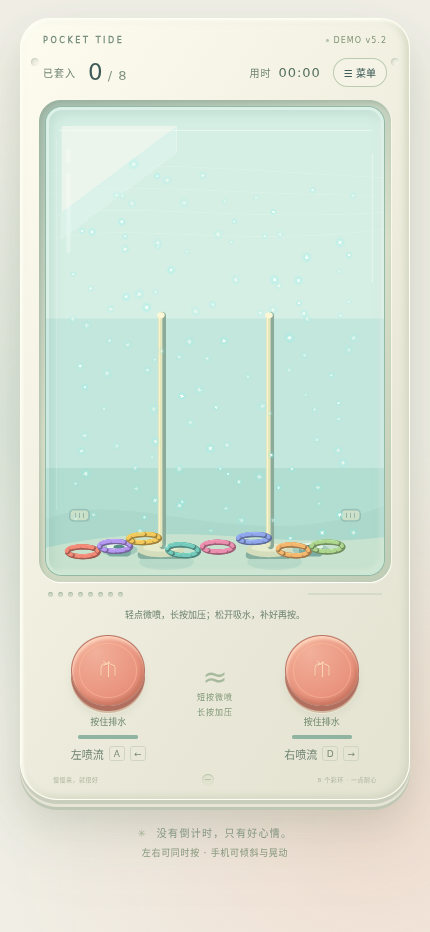

# Pocket Tide · 水中套圈 Demo v5.4

竖版水中套圈玩具。真实 Cocos Engine 3.8.7 WebGL2 绘制、cannon-es 三维刚体。

- 浅青水箱里的白色反光亮片随循环水流移动，缓慢闪烁；停喷后余流逐步衰减。
- 轻点少量低速排水，长按逐渐加压，每侧泵腔容量有限；松手从独立吸水口补水。
- 泵与水箱共用守恒水量，水位随排水/回补变化，上方保留较小空气区。
- 边角圆环可通过底部回流重新进入喷流；底部圆环能随倾斜滑动。
- 圈之间弹性碰撞，真实穿柱并受底座/环堆支撑落稳后计分。
- 支持完整翻转、倒置游玩，浏览器转屏不会自动重设校准；只有菜单中的“校准”会改变基准。
- 使用原生 AABB 剔除不可能的碰撞对，保留全部圆环形状、亮片和120Hz物理；移动性能仍需真机反馈。
- 手机倾斜与摇晃默认开启；需要权限时在菜单授权，可校准或关闭。桌面支持A/D和左右键。
- 菜单中重开；切走页面自动暂停。没有广告或支付。

## 在线试玩

https://chabaoaec.github.io/water-ring-toss-cocos/?build=v5.4

公开静态试玩，右上角显示 **DEMO v5.4**；手机需要权限时在菜单授权传感器。

## 本地试玩

完整Web试玩包解压后运行 `python3 start-demo.py`（Windows可用 `py start-demo.py`），打开提示的 `http://127.0.0.1:8088/?build=v5.4`。右上角应显示 **DEMO v5.4**。启动器读取自身目录并禁止缓存；端口占用会明确报错。需要支持WebGL2的浏览器，不要双击HTML。

从源码运行：

```sh
git clone https://github.com/chabaoaec/water-ring-toss-cocos.git
cd water-ring-toss-cocos/game
npm ci
npm run build
npm start
```

源码预览地址为 http://127.0.0.1:8080 。手机远程打开需要HTTPS才能读取传感器；未获得权限或未收到数据会明确显示状态。



完整实现和边界见[游戏说明](game/README.md)、[验收证据](VALIDATION.md)与[第三方许可](game/THIRD_PARTY_NOTICES.md)。这是独立启动的真实Cocos引擎Web Demo，未使用Creator编辑器导出，不是Creator场景工程。水流是解析近似，自由面随倾斜保持水量，快速摇晃让水和圈产生惯性响应；仍是解析近似，不含完整压力/晃荡求解。尚未完整手动8/8通关；Brave硬件性能与手机真机传感器未验证。


v5.4：圆环物理质量略增5%，实际喷流驱动震动节奏，页面固定并保留全部控制与内部可滚菜单。网页Vibration接口不提供硬件振幅控制；实际手机效果与兼容性仍需试玩确认。

本版还修复叠圈漏计/撤分与偏心斜圈判断，短横屏胜利面板可内部滚动。初次计分规则仍为真实坐稳片刻；113项联合测试与实际Cocos人工初始8圈物理场景通过，范围/限制见 [验收说明](game/evidence/v5.4/ROOT-DECISION.md)。
