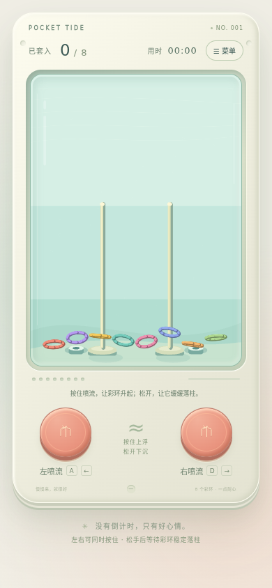

# Pocket Tide · 水中套圈 Demo

竖版水中套圈玩具：按住左右喷流，松开下沉，让彩环实际穿过立柱并落稳。真实 Cocos Engine 3.8.7 WebGL2 绘制、cannon-es 3D刚体；水力为手感近似模型。

## 本地试玩

需要Node.js20+和支持WebGL2的浏览器。

```sh
git clone https://github.com/chabaoaec/water-ring-toss-cocos.git
cd water-ring-toss-cocos/game
npm ci
npm run build
npm start
```

打开 http://127.0.0.1:8080 。手机浏览器可在同一局域网显式运行 `HOST=0.0.0.0 npm start` 后访问电脑IP。

按住左/右按钮或A/D、左右方向键；顶部菜单暂停并提供重新开始。没有倒计时、广告或支付。

完整说明和验证边界见[game/README.md](game/README.md)，第三方许可证见[THIRD_PARTY_NOTICES.md](game/THIRD_PARTY_NOTICES.md)。本版本是独立启动的真实Cocos引擎Web Demo；未使用Creator编辑器构建，不是可直接打开的Creator场景工程。其他浏览器/iOS真机/低端性能尚待验证。


