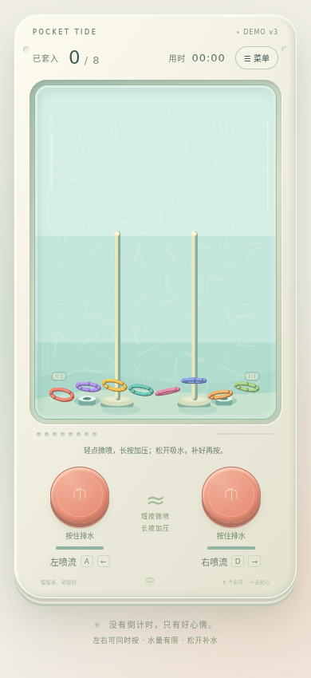

# Pocket Tide · 水中套圈 Demo v3

竖版水中套圈玩具。真实 Cocos Engine 3.8.7 WebGL2 绘制、cannon-es 三维刚体，近似循环水流。

- 水箱里预先分布轻淡悬浮絮流，喷水与吸水都能带动它们。
- 轻点少量低速排水，长按逐渐加压；每侧泵腔容量有限。
- 松开后从独立吸水口回补，空泵补满约0.7秒；提前再按只使用当前水量。
- 左右泵独立；圈之间弹性碰撞，真实穿柱并受底座/环堆支撑落稳后计分。
- 菜单中重开；切走页面自动暂停，回来点击继续。没有广告或支付。

## 本地试玩

完整Web试玩包解压后运行 `python3 start-demo.py`（Windows可用 `py start-demo.py`）。打开提示的 `http://127.0.0.1:8083/?build=v3`，右上角应显示 **DEMO v3**。启动器固定读取自身目录并禁止缓存，端口占用会报错，不会跳到旧服务。需要支持WebGL2的浏览器，不要双击HTML。

从源码运行：

```sh
git clone https://github.com/chabaoaec/water-ring-toss-cocos.git
cd water-ring-toss-cocos/game
npm ci
npm run build
npm start
```

源码预览地址为 http://127.0.0.1:8080 。也支持A/D与左右方向键。



完整实现和边界见[游戏说明](game/README.md)、[验收证据](VALIDATION.md)与[第三方许可](game/THIRD_PARTY_NOTICES.md)。这是独立启动的真实Cocos引擎Web Demo，未使用Creator编辑器导出，不是可直接打开的Creator场景工程。水流与水量账是近似模型，非真实流体/流固耦合求解器。尚未完整手动8/8通关；其他浏览器、iOS真机和低端性能未验证。
