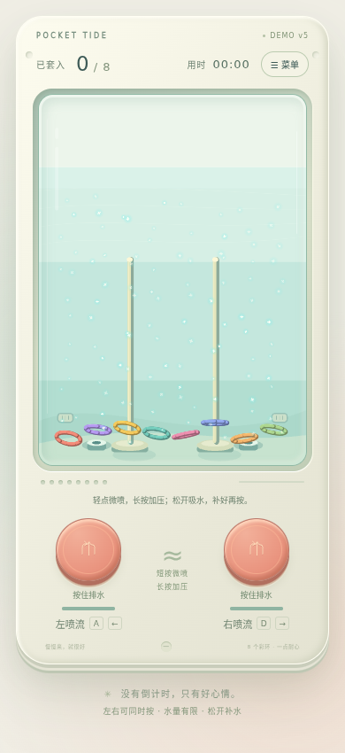

# Pocket Tide · 水中套圈 Demo v5

竖版水中套圈玩具。真实 Cocos Engine 3.8.7 WebGL2 绘制、cannon-es 三维刚体。

- 浅青水箱里的白色反光亮片随循环水流移动，缓慢闪烁。
- 轻点少量低速排水，长按逐渐加压，每侧泵腔容量有限；松手从独立吸水口补水。
- 泵与水箱共用守恒水量，水位随排水/回补变化，上方留有空气区。
- 圈之间弹性碰撞，真实穿柱并受底座/环堆支撑落稳后计分。
- 手机倾斜重力默认开启；需要权限时在菜单授权，可校准或关闭。桌面支持A/D和左右键。
- 菜单中重开；切走页面自动暂停。没有广告或支付。

## 本地试玩

完整Web试玩包解压后运行 `python3 start-demo.py`（Windows可用 `py start-demo.py`），打开提示的 `http://127.0.0.1:8086/?build=v5`。右上角应显示 **DEMO v5**。启动器读取自身目录并禁止缓存；端口占用会明确报错。需要支持WebGL2的浏览器，不要双击HTML。

从源码运行：

```sh
git clone https://github.com/chabaoaec/water-ring-toss-cocos.git
cd water-ring-toss-cocos/game
npm ci
npm run build
npm start
```

源码预览地址为 http://127.0.0.1:8080 。手机远程打开需要HTTPS才能读取传感器；未获得权限或未收到数据会明确显示状态。



完整实现和边界见[游戏说明](game/README.md)、[验收证据](VALIDATION.md)与[第三方许可](game/THIRD_PARTY_NOTICES.md)。这是独立启动的真实Cocos引擎Web Demo，未使用Creator编辑器导出，不是Creator场景工程。水流是解析近似，倾斜时自由面仍保持水平，不含真实晃荡。尚未完整手动8/8通关；Brave硬件性能与手机真机传感器未验证。
